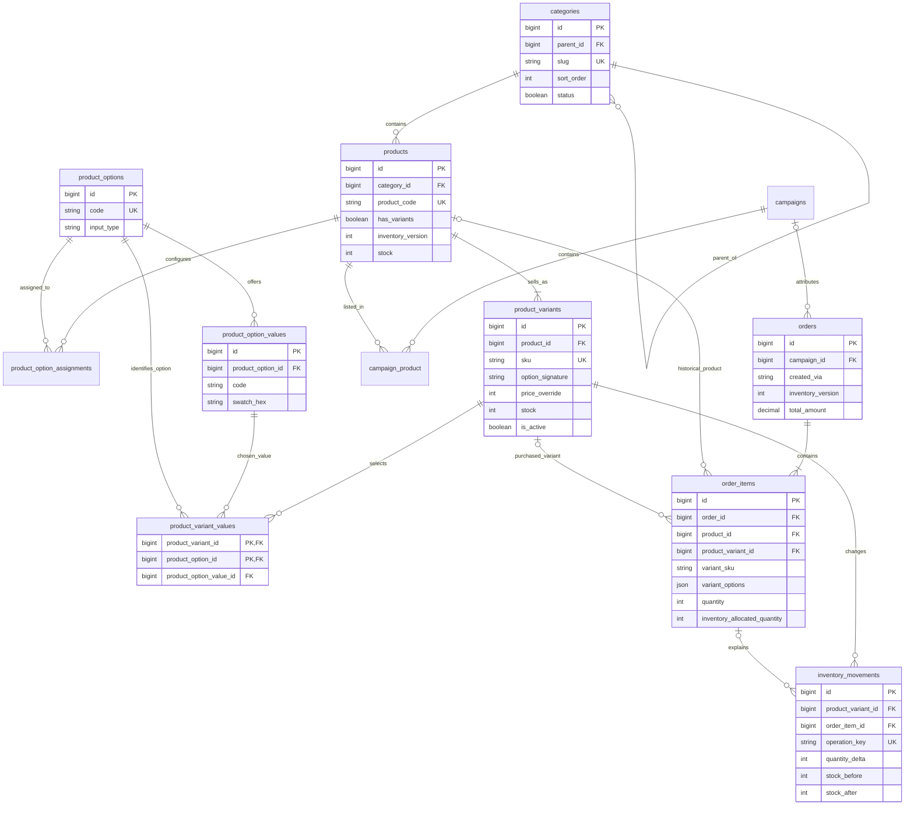
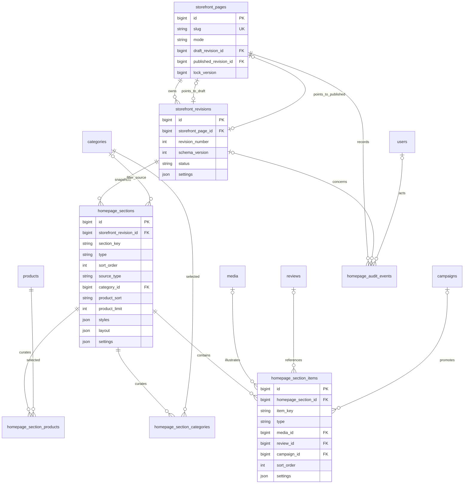
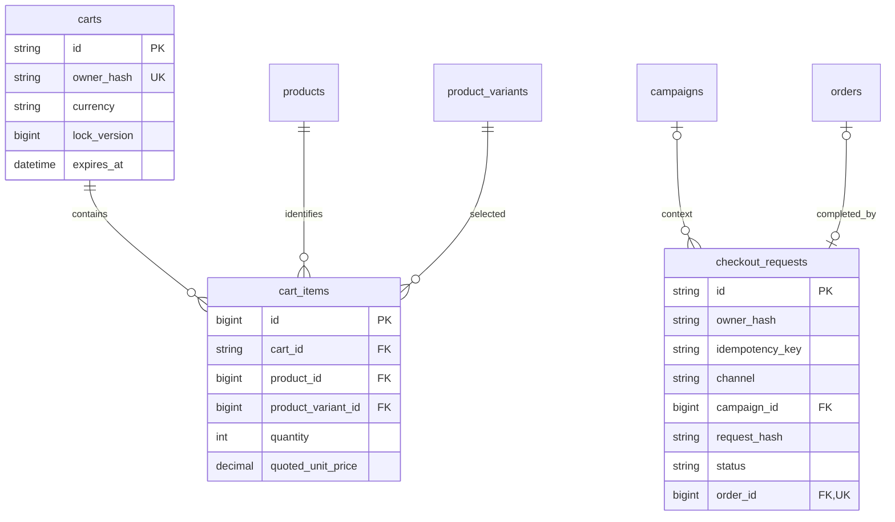

# Entity Relationship Diagrams

**Baseline + proposed extension**, not a representation of an already-migrated database. Existing entities are labeled in diagram comments. Column authority is [database-schema.md](database-schema.md). Mermaid blocks can be previewed in a compatible Markdown viewer.

## 1. Catalog, variants, inventory and orders

`categories`, `products`, `campaigns`, `campaign_product`, `orders` and `order_items` already exist. Variant/ledger tables are proposed. Optional order-line variant relationships preserve old history. All products have one or more variants only after successful backfill; that minimum cardinality is an application invariant, not an FK guarantee.

## 2. Versioned homepage builder

The two page pointers are optional; each must point to a revision belonging to the same page. Revisions own separate section/item rows. `media`, `reviews`, `campaigns`, `categories`, `products`, `users` remain existing entities. Media is reused via approved references rather than duplicated image-path columns.

## 3. Guest storefront cart and idempotent checkout

Cart ownership and checkout ownership share a server-derived guest-token hash, not a public relationship ID supplied by the client. Checkout does not require an FK to a cart: campaign quick-order submissions have no storefront cart. One completed request maps to one order; many legacy orders have no checkout_request. No customer-account relationship is implied.

## Meeting-aligned catalog note

The `product_options` -> `product_option_values` -> `product_variant_values` graph supports **size, color, weight (`1 kg`/`2 kg`) and piece-count/pack values (`1 piece`/`2 pieces`)**, not only size/color. Each concrete combination remains a single `product_variants` row with its own price/stock; the shopping cart `quantity` is different from the option's labeled amount. Until business gate G03 is approved, the meaning of pack stock vs underlying pieces remains conditional. No new redundant table is needed solely for these option names.

### P37 Contact message isolation

`storefront_contact_messages (id PK, encrypted name/email/phone/message/admin_note, subject, status, read_at, created_at, updated_at, deleted_at)`. Standalone private customer correspondence, with no foreign key to `orders` or campaigns. Public contact data continues to be read from the existing one-row active `site_settings` resource.

### P38 isolated additions

- `storefront_faqs` is stand-alone. `faqs` -> `campaigns` relationship stays untouched.
- `site_settings` -> `media` (existing polymorphic Media Library) now uses additional `storefront_logo`, `storefront_white_logo` and `storefront_favicon` collection names; no new FK or column.
- `storefront_revisions` gets nullable `deleted_at` for hidden *archived* histories only; all `storefront_pages` pointers, `homepage_sections` children, and `homepage_audit_events` references are retained.
